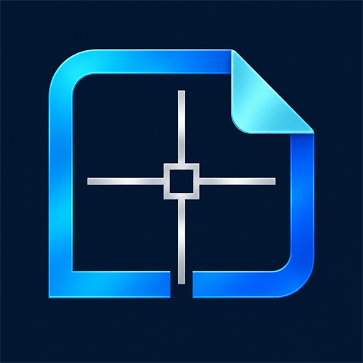

<p align="center"></p>
<h1 align="center">Arcad View</h1>
<p align="center">GUI's Arc Industry · Android CAD 열람 · 측정 · 치수 · 마크업</p>

[공개 대응 소스](https://github.com/gamzagui-collab/ArcadView-Source) · [소스·앱 배포 정책](docs/DISTRIBUTION_CHANNELS.md) · [개인정보 안내](PRIVACY.md)

소스 공개 저장소는 GitHub Actions를 비활성화하여 APK를 빌드하거나 게시하지 않습니다. 배포한 앱 버전과 같은 태그에서 전체 수정 소스와 빌드 절차를 확인할 수 있습니다. Play 전환 전 직원용 APK 배포·업데이트는 기존 저장소에서 유지합니다.

## 기능

- DWG/DXF, PDF와 ZIP/RAR 도면 보관함
- 거리(정렬·선형), 총길이, 면적, 각도, 객체 측정과 블록·해치 경계 스냅
- 폴리라인·총길이·면적의 중간 완료 버튼, 진행 중 직전 구간 표시와 완료 후 결과 확인
- 도면별 단위 기억, 변환·화면 캐시, XCLIP과 한글 도면 글꼴
- 원본을 변경하지 않는 일반 레이어 1~3, 포인트 전용 4번과 치수 전용 5번 레이어
- 폴리라인·원·사각형·한글 텍스트·치수선, 객체 선택·X/Y 이동·옵셋·삭제·트림
- 도면 위 텍스트 직접 입력·길게 눌러 재편집, 글자 크기 슬라이더·색상 팔레트
- 고정 실행 취소·다시 실행·툴 해제, 원형 보기 초기화, 관성 스크롤 도구 목록과 메인 객체 선택·삭제
- 측정·치수선 최대 소수 0~6자리 선택, 포인트 표시 전용 4번 레이어와 화면 고정 굵기
- 남색·파랑·하늘색 UI, 접을 수 있는 측정창과 레이어/그리기/치수 탭
- GitHub 새 릴리스 자동 확인, 사용자 승인 후 검증된 APK 업데이트

도면은 기기에서 처리하며 원본 CAD 파일을 수정하지 않습니다. 주석과 가림은 앱 내부의 오버레이로 저장합니다. 도면 열람은 오프라인으로 작동하고 GitHub 업데이트 확인·다운로드에만 인터넷을 사용합니다. 모든 DWG 객체나 실제 기기에 대한 호환성을 보장하지는 않습니다.

## 설치

[직원용 APK 바로 다운로드 — 2.1.20](https://github.com/gamzagui-collab/ArcadView/releases/download/v2.1.25/Arcad-View-v2.1.25-52.apk)를 눌러 설치하세요. 기존 앱은 제거하지 말고 업데이트 설치합니다. 앱 정보의 **업데이트 확인** 버튼으로 새 버전을 확인할 수 있습니다. 자동 업데이트 확인은 앱 실행과 복귀 때 수행하며 다운로드·설치는 사용자의 승인이 필요합니다. [최신 릴리스의 변경 안내](https://github.com/gamzagui-collab/ArcadView/releases/latest)도 확인할 수 있습니다.

## 빌드

Node.js >=22, JDK21, Android SDK36/build-tools36.0.0, NDK28.2.13676358, CMake3.22.1이 필요합니다. 기존 SDK에 아래 구성요소를 추가할 수 있습니다.

```powershell
sdkmanager.bat "ndk;28.2.13676358" "cmake;3.22.1"
```

Android DWG 변환은 기존 LibreDWG 0.9.0의 동일 C 소스를 별도 프로세스에서 실행합니다. 네이티브 엔진 소스는 `vendor/`에 포함되어 빌드 때 별도 다운로드하지 않습니다. 웹에서는 기존 WASM 경로를 유지합니다.

```powershell
npm.cmd ci
npm.cmd test
npm.cmd run android:prepare
.\android\gradlew.bat -p android assembleDebug
```

서명 APK, GitHub Actions 릴리스, Play용 자체 업데이트 제외 빌드는 [배포 안내](docs/GITHUB_RELEASES.md)를 확인하세요. [Windows/LDPlayer 개발·디버깅](docs/ANDROID_LDPLAYER_DEBUG.md)도 지원합니다.

## 원본과 라이선스

Arcad View는 [orgofjs/izCAD](https://github.com/orgofjs/izCAD)를 기반으로 수정한 GPL-3.0-only 프로젝트입니다. 원저작자와 제3자 고지는 유지합니다. [원본 README](README.upstream.md), [LICENSE](LICENSE), [NOTICE](NOTICE.md), [제3자 라이선스](THIRD_PARTY_LICENSES.md)를 확인하세요. 원본 소스와 전체 수정 소스를 함께 제공합니다.

원본 프로젝트와 Arcad View는 별개의 배포판입니다. Android 패키지 ID는 기존 설치본의 데이터·서명 호환성을 위해 유지합니다.
