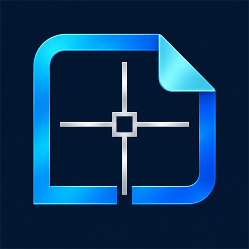

<p align="center">
  
</p>

<h1 align="center">izCAD</h1>

<p align="center">
  Offline DXF & DWG viewer for Android<br>
  Android için çevrimdışı DXF ve DWG görüntüleyici
</p>

<p align="center">
  <a href="#türkçe">Türkçe</a> ·
  <a href="#english">English</a>
</p>

---

## Türkçe

Güncel sürüm: **2.0**. Değişiklikler [CHANGELOG.md](CHANGELOG.md), güncelleme ve imzalama adımları [PLAY_RELEASE_2.0.md](PLAY_RELEASE_2.0.md) dosyasındadır.

izCAD, Android cihazlarda DXF ve DWG çizimlerini tamamen çevrimdışı açmak ve
görüntülemek için geliştirilmiş açık kaynak bir CAD görüntüleyicidir. Uygulama
çizimleri düzenlemez, değiştirmez veya bir sunucuya göndermez.

### Özellikler

- DXF ve DWG dosyalarını cihazdan seçme
- PDF dosyalarını çevrimdışı açma, sayfa değiştirme ve yakınlaştırma
- ZIP ve tek parçalı, şifresiz RAR arşivlerini listeleme; seçilen DXF/DWG/PDF dosyalarını klasör yapısıyla kitaplığa çıkarma
- CAD üzerinde iki nokta mesafesi, toplam uzunluk, kapalı çokgen alanı/çevresi ve açı ölçümü
- Çizgi, çoklu çizgi, daire, yay ve elips uzunluğu; uç/orta/merkez noktalarına tutunma ve birim seçimi
- Koyu arka planla uyumlu şeffaf Android durum çubuğu ve okunur açık renk simgeler
- Aşırı uzak kayıtlı DWG görünümünde içeriğe uygun ilk yakınlaştırma
- Açılan çizimleri uygulamaya özel çevrimdışı Çizim Kitaplığı'nda saklama
- Kitaplıkta klasör oluşturma, yeniden adlandırma, kopyalama, taşıma ve silme
- Kitaplıkta klasör içinde arama, ad/tarih/boyut sıralaması ve toplu dosya ekleme
- Aynı adlı dosyaları mevcut çizimi değiştirmeden ayrı saklama
- Android geri tuşu, hata sonrası tekrar deneme ve kontrollü iptal
- DWG dosyalarını cihaz üzerinde LibreDWG WebAssembly ile DXF'e dönüştürme
- Çevrimdışı çalışma; Android `INTERNET` izni yok
- Pan ve iki parmakla yakınlaştırma
- Yakınlaştır, uzaklaştır, ekrana sığdır ve görünümü sıfırla
- Türkçe, İngilizce ve Korece arayüz
- Yerel TEXT ve MTEXT font desteği
- Android 8.0 (API 26) ve üzeri
- Reklam, kullanıcı hesabı, analytics veya telemetri yok

### Kapsam

izCAD bir görüntüleyici ve 2B CAD ölçüm aracıdır. Ölçümler geçicidir; çizim
içeriğini değiştirme, not ekleme veya düzenlenmiş CAD dosyası kaydetme özelliği
yoktur. PDF üzerinde ölçüm yapılmaz. Çizim Kitaplığı özgün DXF/DWG/PDF ve arşiv
dosyalarını cihazda saklar; arşivden yalnızca desteklenen CAD/PDF dosyaları çıkarılır.
Şifreli veya çok parçalı arşivler ve şifreli PDF bu sürümde desteklenmez.
Ölçü birimi bilinmeyen dosyalarda kullanıcı çizimin birimini seçmelidir.
Elips ve eşit olmayan ölçekle dönüştürülmüş eğriler yaklaşık olarak işaretlenir.

DWG formatının çok sayıda sürümü ve üreticiye özel nesnesi bulunduğu için her
DWG dosyasının eksiksiz görüntüleneceği garanti edilmez. Desteklenmeyen veya
bozuk nesneler kontrollü bir hata oluşturabilir.

### Teknoloji

- React 19 ve TypeScript
- Vite
- Capacitor Android
- Capacitor Browser (yalnızca kullanıcı yasal/kaynak bağlantısına dokunduğunda)
- dxf-viewer ve Three.js
- `@mlightcad/libredwg-web@0.9.0`
- Web Worker ve WebAssembly
- PDF.js (yerel worker, font, CMap ve görüntü çözümleme dosyaları)
- fflate ve libarchive WebAssembly

DWG dosyası ayrı bir Web Worker içinde DXF'e dönüştürülür. Elde edilen DXF
çizimi `dxf-viewer` ile WebGL üzerinde görüntülenir. Bütün işlem cihazda
gerçekleşir.

### Gereksinimler

- Node.js 22 veya üzeri
- npm
- Android Studio
- Android SDK 36
- JDK 21

### Kurulum

```powershell
git clone https://github.com/orgofjs/izCAD.git
cd izCAD
npm.cmd install
npm.cmd run android:prepare
```

Ardından `android/` klasörünü Android Studio ile açıp bir cihaz veya emülatörde
çalıştırın.

### Test ve kaynak doğrulama

```powershell
npm.cmd test
npm.cmd run build
npm.cmd run android:verify
```

### Debug APK

```powershell
npm.cmd run android:prepare
cd android
.\gradlew.bat assembleDebug
```

Oluşan dosya:

```text
android/app/build/outputs/apk/debug/app-debug.apk
```

### Gizlilik

izCAD kişisel veri toplamaz veya paylaşmaz. Seçilen çizimler yalnızca cihaz
üzerinde işlenir.

- [Gizlilik politikası](https://sites.google.com/view/izcad-gp-pp/ana-sayfa)
- [Play Data Safety hazırlığı](PLAY_DATA_SAFETY.md)

### Lisans

Copyright (C) 2026 İZ

izCAD, yalnızca GNU General Public License version 3
([GPL-3.0-only](LICENSE)) koşullarıyla yayımlanır. Üçüncü taraf bildirimleri
[THIRD_PARTY_LICENSES.md](THIRD_PARTY_LICENSES.md) dosyasındadır.

APK dağıtılırken aynı sürüme ait kaynak kodu ve LibreDWG'nin karşılık gelen
kaynak kodu da erişilebilir tutulmalıdır.

### Katkıda bulunma

Hata raporları ve pull request'ler kabul edilir. Gizli veya sahipli CAD
dosyalarını issue'lara yüklemeyin. Örnek çizim gerekiyorsa paylaşım iznine sahip
olduğunuz küçük bir dosya kullanın.

İletişim: [tepukmenajeri@gmail.com](mailto:tepukmenajeri@gmail.com)

---

## English

Current version: **2.0**. See [CHANGELOG.md](CHANGELOG.md) and [PLAY_RELEASE_2.0.md](PLAY_RELEASE_2.0.md) for changes and the Android update/signing workflow.

izCAD is an open-source Android viewer designed to open and display DXF and
DWG drawings entirely offline. It does not edit drawings, modify files, or
upload them to a server.

### Features

- Select DXF and DWG files from the device
- Open PDFs offline, change pages and zoom
- Preview ZIP and single-volume, unencrypted RAR archives; extract selected CAD/PDF files into library folders
- Measure 2D distance, path length, polygon area/perimeter and angles in CAD drawings
- Read line/polyline/circle/arc/ellipse lengths with endpoint/midpoint/center snapping and unit selection
- Transparent Android system bars with readable light icons on the dark interface
- Fit drawing content when a saved DWG camera is excessively distant
- Keep opened drawings in the app-private offline Drawing Library
- Create folders and rename, copy, move, or delete library items
- Search the current folder, sort by name/date/size, and import multiple drawings
- Keep same-named drawings separately without replacing an existing file
- Android back navigation, retry and cancellation
- Convert DWG to DXF locally with LibreDWG WebAssembly
- Fully offline operation with no Android `INTERNET` permission
- Pan and pinch-to-zoom
- Zoom in, zoom out, fit to screen, and reset view
- Turkish, English and Korean interface
- Local font support for TEXT and MTEXT
- Android 8.0 (API 26) and newer
- No ads, accounts, analytics, or telemetry

### Scope

izCAD is a viewer with temporary 2D CAD measurement tools. It does not edit
drawings, add annotations or save modified CAD files. PDFs have no measurement
tools. The library keeps original DXF/DWG/PDF and archive files on the device;
archive extraction imports supported CAD/PDF documents only. Encrypted or
multipart archives and password-protected PDFs are not supported in this version.
Users must select the drawing unit when it is unspecified. Ellipse lengths and
nonuniformly scaled curves are marked approximate.

DWG has many versions and vendor-specific objects, so complete rendering of
every DWG file cannot be guaranteed. Unsupported or damaged objects may
produce a controlled error.

### Technology

- React 19 and TypeScript
- Vite
- Capacitor Android
- Capacitor Browser (only when the user opens a legal/source link)
- dxf-viewer and Three.js
- `@mlightcad/libredwg-web@0.9.0`
- Web Workers and WebAssembly
- PDF.js with local workers, fonts, CMaps and image decoders
- fflate and libarchive WebAssembly

The DWG file is converted to DXF in a dedicated Web Worker. The resulting DXF
is rendered with `dxf-viewer` and WebGL. The entire process stays on the
device.

### Requirements

- Node.js 22 or newer
- npm
- Android Studio
- Android SDK 36
- JDK 21

### Setup

```powershell
git clone https://github.com/orgofjs/izCAD.git
cd izCAD
npm.cmd install
npm.cmd run android:prepare
```

Open the `android/` directory in Android Studio and run it on a device or
emulator.

### Tests and source verification

```powershell
npm.cmd test
npm.cmd run build
npm.cmd run android:verify
```

### Debug APK

```powershell
npm.cmd run android:prepare
cd android
.\gradlew.bat assembleDebug
```

Output:

```text
android/app/build/outputs/apk/debug/app-debug.apk
```

For the optional Windows build/install/Logcat/screenshot workflow with an
explicitly selected LDPlayer instance, see [LDPlayer debugging](docs/ANDROID_LDPLAYER_DEBUG.md).

### Privacy

izCAD does not collect or share personal data. Selected drawings are processed
only on the device and may be retained in the app-private Drawing Library
until the user deletes them, clears app data, or uninstalls the application.

- [Privacy policy](https://sites.google.com/view/izcad-gp-pp/ana-sayfa)
- [Play Data Safety preparation](PLAY_DATA_SAFETY.md)

### License

Copyright (C) 2026 İZ

izCAD is released exclusively under the GNU General Public License version 3
([GPL-3.0-only](LICENSE)). Third-party notices are available in
[THIRD_PARTY_LICENSES.md](THIRD_PARTY_LICENSES.md).

When an APK is distributed, the matching izCAD source and corresponding
LibreDWG source must remain available.

### Contributing

Bug reports and pull requests are welcome. Do not upload confidential or
proprietary CAD files to issues. If a sample drawing is needed, use a small
file that you have permission to redistribute.

Contact: [tepukmenajeri@gmail.com](mailto:tepukmenajeri@gmail.com)
